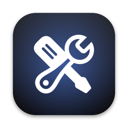

<p align="center"></p>

<h1 align="center">MyToolbox</h1>

<p align="center"><b>97 everyday tools in one native Mac app.</b><br>
Trim, merge, crop and caption video, record your screen and voice, download clips, edit and sign PDFs, redact screenshots, transcribe, translate, and tune your Mac — all on your machine, nothing uploaded.</p>

<p align="center">
<a href="https://github.com/wenayy/MyToolbox/releases/latest"><b>Download</b></a> ·
<a href="#install">Install</a> ·
<a href="#tools">All tools</a> ·
<a href="#build-from-source">Build from source</a>
</p>

---

## Why

Small jobs shouldn't need a dozen apps or a website that keeps your files. MyToolbox puts them in one fast window:

- **Drop anything anywhere.** Drop a file on the window, the Dock icon, or any tool, and MyToolbox offers the tools that can use it.
- **Hover to switch.** Rest on a tool in the sidebar and it opens. Or press <kbd>⌃⌥Space</kbd> from any app to jump straight to a tool.
- **One output folder.** Every result lands in `~/Downloads/MyToolbox`, never overwriting anything. Drag results straight out into Finder, Mail or any app.
- **See and hear it before you save.** Video and audio tools show a live preview of the result as you change settings — a few seconds of your file made with the real settings, with a Before / After switch to compare. Burned-in captions, new speed, cleaned-up sound, black bars, crops and GIFs all show up before anything is written.
- **Pause, resume, preview.** Long downloads and compressions can be paused. Results can be previewed right inside the tool.
- **Private by design.** Text recognition, transcription, translation, summaries, background removal and recording run on-device with Apple's frameworks. Nothing is sent anywhere — except Download Video, which fetches the link you give it.

## Install

**Requirements:** macOS 26 Tahoe or later. Apple silicon or Intel. Apple Intelligence features (Summarize, Ask a Document) need a Mac that supports them.

### Option 1 — one line in Terminal (easiest)

```sh
curl -fsSL https://raw.githubusercontent.com/wenayy/MyToolbox/main/scripts/install.sh | bash
```

This downloads the latest release into `/Applications` and opens it. Run it again any time to update.

### Option 2 — download the app

1. Download `MyToolbox-x.y.z.zip` from the [latest release](https://github.com/wenayy/MyToolbox/releases/latest) and unzip it.
2. Drag **MyToolbox** into **Applications**.
3. The app is open-source and not notarized by Apple, so the first time macOS will say it can't check it. Either:
   - open **System Settings → Privacy & Security**, scroll down and click **Open Anyway**, or
   - run `xattr -dr com.apple.quarantine /Applications/MyToolbox.app` in Terminal.

### Free helpers

A few tools use well-known open-source programs. MyToolbox shows which ones are missing and installs them for you with [Homebrew](https://brew.sh) (**Settings → Helpers → Install**):

| Helper | Used by |
|---|---|
| `ffmpeg` | Every video and audio tool except Record Screen and Record Audio |
| `yt-dlp` | Download Video |
| `qpdf` | PDF passwords (stronger encryption; a built-in fallback exists) |
| `pandoc` | Markdown conversions |
| `webp` | Saving WebP images |
| LibreOffice | Word, PowerPoint and Excel to PDF |

Or all at once: `brew install ffmpeg yt-dlp qpdf pandoc webp`

Tested with ffmpeg 8.1 and 9.0, yt-dlp 2026.10.26.

## Tools

<details open>
<summary><b>Video</b> — 15 tools</summary>

| Tool | What it does |
|---|---|
| Download Video | Save videos or audio from YouTube, X, Instagram, TikTok and 1000+ sites |
| Compress Video | Make videos smaller with barely visible quality loss |
| Convert Video | Turn videos into MP4, MOV, WebM, MKV or ProRes — instantly when no re-encoding is needed |
| Video to GIF | Make a looping GIF from a clip, with sharp colours and a size you choose |
| Trim Video | Cut the start and end of a clip on a timeline, without re-encoding (or frame-exact) |
| Merge Videos | Join several clips into one MP4 in the order you choose; different shapes get black bars |
| Crop & Rotate Video | Drag a crop frame (freeform, 1:1, 16:9, 9:16, 4:3, 4:5), rotate and flip |
| Resize Video | 4K, 1080p, 720p, 480p, square, vertical or an exact size — fit, black bars or crop to fill |
| Change Speed | 0.25× to 4×, keeping voices at their natural pitch, or muted |
| Burn In Subtitles | Draw captions into the picture from an SRT/WebVTT file or an on-device transcription |
| Replace Audio | Put new music or narration under a video — looped or once — or mix it with the original |
| Mute Video | Remove the sound without re-encoding |
| Extract Frames | Stills every N seconds, evenly spaced, or one moment — PNG, JPEG or HEIC at original, 1080p or 720p |
| Media Info | Codec, resolution, frame rate, bitrate, HDR, device and location; copy as text or export JSON |
| Record Screen | Record a display, a window or an area, with system audio and microphone, at 30 or 60 fps |

</details>

<details>
<summary><b>Audio</b> — 5 tools</summary>

| Tool | What it does |
|---|---|
| Record Audio | Record your voice in M4A or WAV, mono or stereo, then transcribe it on device |
| Trim Audio | Cut a song or recording down, with fade in and fade out, keeping its format |
| Clean Up Audio | Reduce background noise, rumble and hiss in recordings and videos, even out loudness, remove silences |
| Extract Audio | Save the soundtrack of a video as M4A, MP3 or WAV |
| Convert Audio | Switch audio between MP3, M4A, WAV, FLAC, Opus and OGG |

</details>

<details>
<summary><b>Images</b> — 11 tools</summary>

| Tool | What it does |
|---|---|
| Blur Faces | Find faces in photos and blur, pixelate or black them out |
| Beautify Screenshot | Put screenshots on a background with padding, rounded corners and a shadow |
| Remove Background | Lift the subject out of photos and save it with a transparent or solid background |
| Convert Images | Save photos as JPEG, PNG, HEIC, TIFF or WebP |
| Compress Images | Make photos smaller without visible loss in quality |
| Resize Images | Scale photos by percentage, longest side or exact size |
| Rotate Images | Rotate or flip many photos at once |
| Remove Metadata | Strip location, camera and date info from photos |
| Color Picker | Pick any color on screen and copy it as HEX, RGB, HSL or code |
| Redact Image | Blur, pixelate or black out any part of a photo or screenshot |
| Annotate Screenshot | Add arrows, boxes, text and numbered steps to a screenshot |

</details>

<details open>
<summary><b>Docs & PDF</b> — 24 tools</summary>

| Tool | What it does |
|---|---|
| Scan Document | Scan paper with your iPhone or from photos. Pages are found, straightened and cleaned up into one PDF |
| Redact PDF | Black out names, numbers or whole areas so they're removed for good, not just covered up |
| Fill & Flatten Forms | Fill in PDF forms, add text where there are no fields, and flatten the answers |
| Make PDF Searchable | Add an invisible text layer to scanned PDFs so you can search, select and copy their text |
| PDF to Word | Turn PDFs into Word documents you can edit, with headings, lists and paragraphs |
| Sign PDF | Draw or type your signature and place it on a document |
| Merge PDFs | Combine several PDFs and images into one document |
| Split PDF | Break a PDF into single pages or page ranges |
| Organize PDF | Reorder, rotate and remove pages in a PDF |
| Delete Pages | Remove the pages you don't need from a PDF |
| Extract Pages | Save selected pages as a new PDF |
| Images to PDF | Turn photos and scans into a single PDF document |
| Crop PDF | Crop pages to a smaller size — like a 4 × 6 in shipping label — or trim every page's margins |
| Compress PDF | Make PDFs smaller by recompressing their images |
| Add Password | Protect PDFs with a password and limit printing or copying |
| Remove Password | Save an unlocked copy of a password-protected PDF you own |
| PDF to Images | Save every page of a PDF as a PNG, JPEG or HEIC image |
| Convert Documents | Switch documents between Word, OpenDocument, RTF, HTML, plain text and Markdown |
| Word to PDF | Turn Word, RTF and text documents into PDFs |
| PowerPoint to PDF | Turn slide decks into PDFs with Keynote or LibreOffice |
| Excel to PDF | Turn spreadsheets into PDFs with Numbers or LibreOffice |
| Web Page to PDF | Save web pages as PDFs, on pages or as one long page |
| Markdown to PDF | Typeset Markdown notes and READMEs as clean PDFs |
| PDF Editor | Mark up, draw, add text, notes, images and signatures, edit text, and rearrange pages — all in one place |

</details>

<details>
<summary><b>Text & Speech</b> — 9 tools</summary>

| Tool | What it does |
|---|---|
| Transcribe | Turn speech in audio and video into a timestamped transcript or subtitles |
| Summarize | Summarize text and documents on device with Apple Intelligence |
| Extract Text | Recognize text in images, screenshots and scanned PDFs |
| Capture Text | Select any area of the screen and copy the text in it (⌃⌥T) |
| Translate | Translate text, documents and subtitles on device, keeping formatting and timings |
| Text to Speech | Read text, documents and PDFs aloud, and save it as audio |
| Ask a Document | Ask questions about a PDF or document and get answers with page references |
| Word Counter | Count words, characters, sentences and paragraphs, with reading time |
| Case Converter | Switch text between UPPERCASE, lowercase, Title Case, camelCase, snake_case and more |

</details>

<details>
<summary><b>Files</b> — 5 tools</summary>

| Tool | What it does |
|---|---|
| QR Code | Make QR codes for links, text and Wi-Fi, or read codes and barcodes from images |
| Batch Rename | Rename many files at once with find and replace, numbering, dates or case changes |
| Find Duplicates | Find identical files across folders and move the extras to the Trash |
| Zip & Unzip | Open ZIP, RAR, 7z and TAR files, or make a ZIP, with a password if you like |
| Organize Downloads | Sort downloaded images by the site they came from (X, Instagram, Pinterest…) into folders or Photos albums |

</details>

<details>
<summary><b>Mac</b> — 16 tools</summary>

| Tool | What it does |
|---|---|
| Network Speed Test | Measure download, upload and responsiveness with Apple's own network test |
| Storage Explorer | See what's filling your disk, find the usual space hogs and clear them out safely |
| Wi-Fi Password & QR | Show the password of a saved Wi-Fi network and make a QR code guests can scan to join |
| Battery Health | See battery capacity, cycle count and charger, plus AirPods and accessory levels |
| Keep Awake | Stop your Mac from sleeping during downloads, renders or talks, for as long as you choose |
| Uninstall App | Remove an app together with the caches, preferences and data it leaves behind |
| Presentation Mode | One switch before you share your screen: hide desktop icons, hide the Dock and stay awake |
| Clean Keyboard | Pause the keyboard so you can wipe the keys, with an optional black screen for the display |
| Dead Pixel Test | Fill every display with solid colours to spot dead, stuck or hot pixels and backlight bleed |
| Eject All Disks | Safely eject every external drive, card and disk image at once before you unplug |
| Login & Background Items | See what starts with your Mac and runs in the background, who made it, and turn off what you don't need |
| Fix “App Is Damaged” | Check who made an app that won't open, then clear the quarantine so macOS lets it run |
| Reset Permissions | Unstick an app's Screen Recording, Microphone, Camera or other privacy access so macOS asks again |
| Hidden Settings | Switch on useful macOS settings that aren't in System Settings, like a faster Dock or hidden files |
| Display Control | Change the brightness, contrast and volume of your displays, including external monitors |
| Mouse Fixes | Scroll your mouse and trackpad in different directions, and make the mouse wheel faster |

</details>

<details>
<summary><b>Developer</b> — 12 tools</summary>

| Tool | What it does |
|---|---|
| JSON Formatter | Pretty-print, minify and validate JSON, with the line and column of any mistake |
| Base64 | Encode and decode Base64 text and files, with URL-safe and line-wrap options |
| Hash Generator | MD5, SHA-1 and SHA-2 checksums of text or files of any size, checked against an expected hash |
| UUID Generator | Make random v4 or time-ordered v7 UUIDs in bulk, and inspect any UUID |
| JWT Decoder | Read a JSON Web Token's header and claims, see when it expires, and check HMAC signatures |
| Timestamp Converter | Turn Unix timestamps into dates and back, in s, ms or µs, in any time zone |
| Diff Checker | Compare two texts or files side by side or inline, with changed words highlighted |
| Regex Tester | Test regular expressions with live highlights, capture groups and a replace preview |
| Clean Links | Strip tracking like utm_source and fbclid from links, and unwrap Google and Facebook redirects |
| Coordinate Picker | Click a map or search a place for its coordinates, measure distances, look up a list |
| Unicode Inspector | See every character and find hidden ones: zero-width spaces, odd spaces and look-alike letters |
| Lorem Ipsum | Make placeholder text by the word, sentence or paragraph, as plain text, HTML or Markdown |

</details>

## Keyboard

| Shortcut | Action |
|---|---|
| <kbd>⌃⌥Space</kbd> | Open any tool, from any app |
| <kbd>⌃⌥T</kbd> | Capture text from anywhere on screen |
| <kbd>⌘K</kbd> | Quick Open inside the window |
| <kbd>⌘↩</kbd> | Run the current tool |
| <kbd>⌘P</kbd> | Pause / resume a running batch |
| <kbd>⌘[</kbd> <kbd>⌘]</kbd> | Back / Forward |
| <kbd>⌘1</kbd> … <kbd>⌘8</kbd> | Jump to a category |

## Build from source

Only the Xcode **Command Line Tools** are needed (`xcode-select --install`).

```sh
git clone https://github.com/wenayy/MyToolbox.git
cd MyToolbox
./scripts/build.sh install     # builds a universal app, copies it to /Applications and opens it
```

Tests:

```sh
# Logic and integration checks (add "fast" to skip network and on-device AI)
swiftc -O -swift-version 5 -o .build/harness $(find Sources/MyToolbox -name '*.swift' ! -name MyToolboxApp.swift) Tests/harness/main.swift && .build/harness

# End-to-end: every file tool's real Run action on video, audio, images, PDFs and Office files generated from scratch
swiftc -O -swift-version 5 -o .build/e2e $(find Sources/MyToolbox -name '*.swift' ! -name MyToolboxApp.swift) Tests/e2e/main.swift && .build/e2e

# Off-screen screenshots of every tool, for reviewing the UI
swiftc -O -swift-version 5 -o .build/snapshots $(find Sources/MyToolbox -name '*.swift' ! -name MyToolboxApp.swift) Tests/snapshots/main.swift && .build/snapshots /tmp/shots
```

The project is plain SwiftPM + SwiftUI: `Sources/MyToolbox/Core` holds the app shell (navigation, drag and drop, the shared batch layout, output folder), and `Sources/MyToolbox/Tools` holds the tools, grouped by category.

## Privacy

MyToolbox has no analytics, no accounts and no network calls of its own. Download Video talks to the site you paste. Network Speed Test uses Apple's `networkQuality` servers. Everything else stays on your Mac.

## Credits

Inspired by [Mac Toolbox](https://mactoolbox.app) and [OneMac](https://onemacapp.com). MyToolbox is an independent open-source project and is not affiliated with either. Built on Apple's frameworks plus [ffmpeg](https://ffmpeg.org), [yt-dlp](https://github.com/yt-dlp/yt-dlp), [qpdf](https://qpdf.sourceforge.io), [pandoc](https://pandoc.org) and [libwebp](https://developers.google.com/speed/webp).

## License

[MIT](LICENSE)
